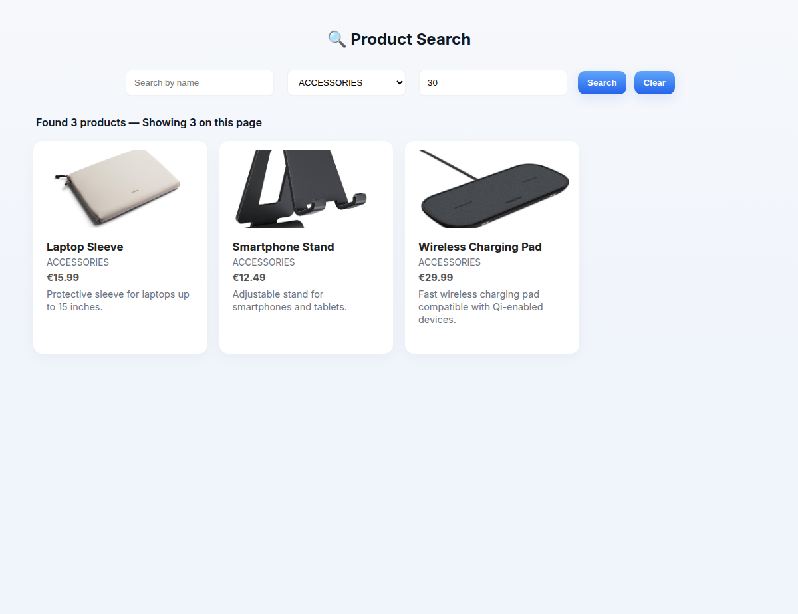

# Product Search

Un catalogo di prodotti con la ricerca per nome, categoria e prezzo massimo, diviso in pagine.
Il backend è in **Spring Boot 3.5** (Java 21) e interroga **PostgreSQL** con `JdbcTemplate`, scrivendo
l'SQL a mano; il frontend è in **Angular 20**, con componenti standalone e il control flow `@if`/`@for`.



Il progetto è spiegato passo per passo nel tutorial
[Ricerca prodotti con Spring Boot e Angular: filtri, paginazione e JdbcTemplate](https://www.giorgiodifusco.it/blog/ricerca-prodotti-con-spring-boot-e-angular-filtri-paginazione-e-jdbctemplate)
sul mio sito.

## Come si avvia

Servono Java 21 o successivo, Node.js 20 o successivo e un PostgreSQL. Il modo più rapido per avere
il database è Docker:

```sh
docker run -d --name product-db -e POSTGRES_USER=product -e POSTGRES_PASSWORD=product \
       -e POSTGRES_DB=product-db -p 5432:5432 postgres:17-alpine
```

Il backend legge le credenziali dalle variabili d'ambiente e va avviato dalla sua cartella,
perché le immagini dei prodotti stanno in `uploads/products/`:

```sh
cd product-search-backend
export DB_USERNAME=product DB_PASSWORD=product
./mvnw spring-boot:run          # http://localhost:8080
```

A ogni avvio Spring esegue `schema.sql`, che crea la tabella `products` se non c'è, e `data.sql`,
che inserisce quindici prodotti di esempio solo se la tabella è vuota. Poi il frontend, in un altro terminale:

```sh
cd product-search-ui
npm ci
npm start                       # http://localhost:4200
```

In sviluppo `ng serve` inoltra al backend le richieste a `/products` e `/uploads`
(`proxy.conf.json`): il frontend usa indirizzi relativi e non serve configurare il CORS.

| Variabile | Predefinito | A cosa serve |
|---|---|---|
| `DB_URL` | `jdbc:postgresql://localhost:5432/product-db` | l'indirizzo JDBC del database |
| `DB_USERNAME` | `postgres` | l'utente del database |
| `DB_PASSWORD` | vuota | la sua password |
| `SERVER_PORT` | `8080` | la porta del backend (se la cambi, cambiala anche in `proxy.conf.json`) |

## L'API

| Endpoint | Che cosa fa |
|---|---|
| `GET /products/search` | i prodotti filtrati e ordinati per nome; parametri facoltativi `name`, `category`, `maxPrice`, `page` (da 0), `size` (da 1 a 100, predefinito 10) |
| `GET /products/categories` | le categorie possibili |
| `GET /uploads/products/{file}` | le immagini dei prodotti |
| `GET /swagger-ui.html` | la documentazione interattiva generata da springdoc |

```text
$ curl -s 'localhost:8080/products/search?name=mouse'
{"content":[{"id":1,"name":"Wireless Mouse","description":"A high-precision wireless mouse with ergonomic design.",
  "price":25.99,"category":"ELECTRONICS","image":"/uploads/products/wireless_mouse.jpg"}],
 "pageNumber":0,"pageSize":10,"totalElements":1}

$ curl -s 'localhost:8080/products/search?category=SHOES'
{"type":"about:blank","title":"Bad Request","status":400,
 "detail":"unknown category: SHOES; allowed values: [ELECTRONICS, FASHION, HOME_APPLIANCES, BOOKS, TOYS, GROCERIES, ACCESSORIES]",
 "instance":"/products/search"}
```

## Test

```sh
cd product-search-backend && ./mvnw test     # serve Docker: Testcontainers avvia un PostgreSQL vuoto
cd product-search-ui && npm test
```

I test del backend avviano l'applicazione intera su un database nuovo. Controllano la ricerca senza
distinzione di maiuscole, i caratteri `%` e `_` presi alla lettera, le pagine in ordine di nome,
i prezzi con i centesimi e i parametri sbagliati che rispondono 400. Quelli del frontend usano
`HttpTestingController` e controllano, per esempio, che una nuova ricerca riparta dalla prima pagina.
